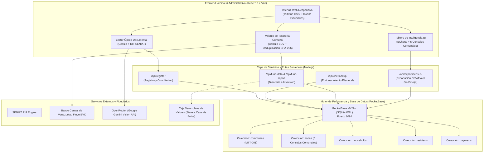

# Dossier Técnico e Institucional: Plataforma de Inteligencia Sociodemográfica y Gestión Fiscal Comunal

## Comuna Socialista Mao Tse Tung · Parroquia San Agustín, Municipio Bolivariano Libertador, Caracas
**Escuela Nacional de Administración y Hacienda Pública (ENAHP-IUT)**  
**Dirección de Extensión Universitaria · Coordinación de Servicio Comunitario**  
**Carrera: Ciencias Fiscales (Menciones: Finanzas Públicas, Rentas y Aduanas)**  
**Fecha de Emisión:** Octubre 2026  
**Documento de Referencia Base:** Instrumento Diagnóstico Comunitario Comuna Mao Tse Tung (2026)  

---

## 1. Resumen Ejecutivo y Objeto Académico-Institucional

El presente dossier documenta la arquitectura técnica, funcional y metodológica del sistema integral desarrollado para la **Comuna Socialista Mao Tse Tung**, ubicada en la Parroquia San Agustín del Municipio Bolivariano Libertador, Distrito Capital.

Este proyecto tecnológico constituye el soporte operacional, empírico y analítico para la ejecución del **Servicio Comunitario de la Escuela Nacional de Administración y Hacienda Pública (ENAHP-IUT)**, en el marco de la Ley de Servicio Comunitario del Estudiante de Educación Superior y los postulados de la Ley Orgánica del Poder Popular, la Ley Orgánica de las Comunas y la Ley Orgánica de los Consejos Comunales.

### 1.1 Objetivos Generales
1. **Sistematización Digital del Territorio:** Superar el levantamiento manual en cuadernos o planillas de papel, implementando una arquitectura digital en tiempo real que caracterice los hogares y residentes de los 5 Consejos Comunales que conforman la Comuna Mao Tse Tung.
2. **Gestión Fiduciaria y Transparencia Fiscal:** Proveer herramientas contables y de tesorería automatizadas para la administración comunal, con conciliación bancaria de transferencias y pagos móviles en Bolívares (VES), cálculo de equivalencias fiduciarias a tasa oficial del Banco Central de Venezuela (BCV), y trazabilidad de aportes al Fondo Comunal de Inversión y Desarrollo.
3. **Inclusión Financiera y Democratización del Capital:** Identificar y evaluar el perfil socioeconómico de las familias para canalizar oportunidades de inclusión bursátil, microinversiones comunitarias y participación en el Mercado de Valores de Caracas (BVC) mediante el Índice de Potencial Finve.

---

## 2. Ámbito Territorial y Estructura Organizativa de la Comuna

La Comuna Mao Tse Tung integra una densidad urbana clave en el corazón geográfico de Caracas, comprendiendo cinco (5) Consejos Comunales plenamente delimitados:

| Código | Consejo Comunal | Abreviación | Sector Geográfico |
|---|---|---|---|
| `CC-SAC` | Consejo Comunal San Agustín Centro | `SAC` | Casco Central, Av. Leonardo Ruiz Pineda |
| `CC-MNG` | Consejo Comunal El Manguito | `MNG` | Zona Media, Estación Metrocable El Manguito |
| `CC-LCH` | Consejo Comunal La Charneca | `LCH` | Eje Este, Conexión hacia Av. Fuerzas Armadas |
| `CC-HDC` | Consejo Comunal Hornos de Cal | `HDC` | Eje Sur, Sector Histórico Hornos de Cal |
| `CC-MRN` | Consejo Comunal Marín | `MRN` | Eje Cultural y Deportivo de San Agustín del Sur |

### 2.1 Centros Electorales de Referencia
El sistema integra los centros de votación del Consejo Nacional Electoral (CNE) que prestan servicio a la parroquia:
- E.B.N. Bicentenario Republicano
- Liceo Bolivariano de Formación Cultural San Agustín
- Escuela Básica Experimental Venezuela
- Unidad Educativa Distrital Sucre
- Colegio La Consolación

---

## 3. Correspondencia Técnica con los 10 Bloques del Instrumento Diagnóstico ENAHP

La plataforma fue diseñada tomando como especificación los diez (10) bloques temáticos del instrumento de diagnóstico sociodemográfico y fiscal de la ENAHP:

### Bloque I: Caracterización Territorial y Demográfica
- **Especificación:** Identificación de límites comunales, consejos comunales integrantes, número de manzanas, veredas, callejones y viviendas habitadas.
- **Implementación Técnica:** Base de datos relacional sobre SQLite/PocketBase con códigos estandarizados de vivienda (`MTT-[CONSEJO]-[NUMERO_CASA]`), vinculación a viviendas físicas en la colección `dwellings` y visualización cartográfica en `CommunityMap.jsx` mediante React-Leaflet y capas OpenStreetMap georreferenciadas (lat: 10.4940, lng: -66.9048).

### Bloque II: Estructura Social y Familiar (Censo de Jefaturas)
- **Especificación:** Relación de parentesco, condición del jefe o jefa de hogar, núcleos familiares convivientes en una misma unidad habitacional y carga familiar de menores y dependientes.
- **Implementación Técnica:** Módulo de escaneo con visión óptica por inteligencia artificial (`documentScanner.js`) que extrae con precisión forense nombres, apellidos, fecha de nacimiento y sexo desde la Cédula de Identidad; formulario progresivo de 4 pasos (`RegistrationFlow.jsx`) que registra parentesco formal y dependientes sin duplicación de registros habitacionales.

### Bloque III: Salud Comunitaria, Vulnerabilidad y Epidemiología
- **Especificación:** Padecimiento de enfermedades crónicas no transmisibles (hipertensión, diabetes, afecciones renales, patologías respiratorias), personas con discapacidad y requerimiento de medicación continua.
- **Implementación Técnica:** Campo estructurado `chronicDiseases`, `regularMedications` y `conditionAffection` en la colección `residents`; motor analítico en `communityAnalytics.js` (`buildHealthVulnerabilityData`) que produce semáforos de riesgo y conteos agregados para la entrega priorizada de insumos médicos.

### Bloque IV: Servicios Públicos e Infraestructura Crítica
- **Especificación:** Sistema de abastecimiento de gas doméstico (número de cilindros, capacidad en 10kg/18kg/43kg, tipo de válvula rosca o pico rápido, proveedor Gas Caracas/PDVSA Gas), frecuencia del ciclo del agua y capacidad de tanques de reserva.
- **Implementación Técnica:** Atributos normalizados en la jefatura de hogar (`gasCylindersCount`, `gasCylinderSize`, `gasValveType`, `waterTankCapacity`); agregación visual en ECharts mediante gráficos de distribución de cilindros y matriz de almacenamiento de agua para contingencias hídricas.

### Bloque V: Soberanía Alimentaria y Logística de Distribución (CLAP)
- **Especificación:** Padrón de beneficiarios de combos de alimentos CLAP, pagos recibidos, control de entregas puerta a puerta y retiro por autorizados.
- **Implementación Técnica:** Módulo `Clap.jsx` con conciliación de estatus (Pendiente, Pagado, Entregado, Retirado), registro de cédula del recolector para auditoría y visualización de cobertura por consejo comunal.

### Bloque VI: Administración, Finanzas Públicas y Tesorería Comunal
- **Especificación:** Gestión del Fondo Comunal conforme a los Artículos 44 y 45 de la Ley Orgánica de los Consejos Comunales. Registro de aportes vecinales en bolívares, verificación de referencias de Pago Móvil, control de ingresos extraordinarios y rendición de cuentas pública.
- **Implementación Técnica:** Módulo fiduciario `TreasuryFund.jsx`, pasarela de validación con cálculo de hash criptográfico SHA-256 (`computeFileSha256`) para impedir aportes duplicados; lector de comprobantes bancarios mediante Gemini Flash Vision (`analyzeFundReceipt`); clasificación contable automática (`verified`, `variance_detected`, `pending_review`).

### Bloque VII: Protección Fiscal y Multi-Moneda (VES / USD)
- **Especificación:** Control de la pérdida de poder adquisitivo por inflación y depreciación cambiaria, cálculo de metas financieras en valor real constante.
- **Implementación Técnica:** Integración en tiempo real con tasas oficiales del BCV (`finveRates.js` y endpoint `/api/fund-rate`), cálculo de cuota familiar equivalente (1.000 Bs / tasa BCV) y proyección de recaudación anualizada en dólares fiduciarios.

### Bloque VIII: Contraloría Social, Auditoría y Rendición de Asambleas
- **Especificación:** Art. 34 de la Ley Orgánica de las Comunas: los voceros deben rendir cuentas trimestralmente ante la Asamblea de Ciudadanos y Ciudadanas con soportes documentales.
- **Implementación Técnica:** Módulo de exportación fiduciaria (`api/export/census.js` y `communityAnalytics.js`) que genera planillas en formato CSV compatible con hojas de cálculo y libros contables de la ENAHP, con estricto cumplimiento de la Política de Cero Emojis para preservar el decoro institucional.

### Bloque IX: Economía Comunal y Oficios Productivos
- **Especificación:** Registro de capacidades técnicas, mano de obra especializada y emprendimientos locales en el territorio para contrataciones comunitarias.
- **Implementación Técnica:** Campo `communityTrade` clasificado en 15 categorías clave (Albañilería, Electricidad, Plomería, Mecánica, Educación, Salud, Costura, Carpintería, etc.) y reflejado en el tablero de inteligencia BI para asignación de cuadrillas de servicios comunales.

### Bloque X: Inclusión Financiera y Apertura Bursátil (Índice de Potencial Finve)
- **Especificación:** Evaluación de la aptitud de los jefes de hogar y emprendedores para acceder a mecanismos formales de ahorro e inversión en la Bolsa de Valores de Caracas (BVC).
- **Implementación Técnica:** Algoritmo cuantitativo determinista de 4 pilares (`calculateFinvePotentialScore` en `communityAnalytics.js`):
  1. **Pilar Identidad y Cumplimiento KYC (0-25 pts):** Cédula laminada vigente, RIF fiscal actualizado del SENIAT y domicilio validado.
  2. **Pilar Económico y Capacidad Productiva (0-25 pts):** Oficio técnico o profesional remunerado, tenencia habitacional propia y no depender de transferencias de emergencia.
  3. **Pilar Estabilidad y Compromiso Comunitario (0-25 pts):** Cumplimiento en el pago de aportes de tesorería comunal y estabilidad residencial en el sector.
  4. **Pilar Digital y Bancarización (0-25 pts):** Uso activo de telefonía inteligente, correo electrónico, canales bancarios electrónicos y lectura óptica digital.
- **Resultado:** Calificación de 0 a 100 puntos y clasificación en segmentos institucionales (`Apto Bursátil Inmediato`, `Potencial Alto`, `Potencial Medio`, `Prioridad Social Básica`).

---

## 4. Marco Jurídico Venezolano Aplicable

El desarrollo y despliegue del sistema `maotsetung-comuna` se fundamenta en las siguientes leyes vigentes de la República Bolivariana de Venezuela:

1. **Constitución de la República Bolivariana de Venezuela (CRBV):**
   - **Artículo 70:** Reconocimiento de la autogestión, las cooperativas, las empresas comunitarias y las asambleas ciudadanas como medios de participación protagónica.
   - **Artículo 184:** Transferencia de competencias y recursos desde los municipios y estados hacia las comunidades organizadas y comunas.
2. **Ley Orgánica del Poder Popular:**
   - **Artículo 8:** Principios de transparencia, corresponsabilidad, rendición de cuentas, control social y soberanía en la gestión comunitaria.
3. **Ley Orgánica de las Comunas:**
   - **Artículo 27 al 34:** Estructura del Banco de la Comuna, administración de los fondos internos (Fondo de Inversión Productiva, Fondo de Acción Social, Fondo de Reserva) y obligación de auditoría trimestral.
4. **Ley Orgánica de los Consejos Comunales (Reforma 2023):**
   - **Artículos 44 y 45:** Creación y manejo de la Unidad Administrativa y Financiera Comunitaria, obligatoriedad del registro contable de recursos no retornables y retornables.
5. **Ley Orgánica de la Administración Financiera del Sector Público:**
   - Normas técnicas sobre el principio de unidad de tesorería, registro fiduciario del gasto y control de inventarios públicos.
6. **Ley del Mercado de Valores (Gaceta Oficial Extraordinaria N° 6.211):**
   - Disposiciones sobre democratización de la propiedad accionaria, acceso a títulos de deuda y fideicomisos comunitarios a través de la Bolsa de Valores de Caracas y la Caja Venezolana de Valores (CVV).

---

## 5. Arquitectura Tecnológica del Sistema



### 5.1 Componentes Principales
- **Entorno de Ejecución:** Node.js v20+, Vite 6, React 18, React-Leaflet 4, Apache ECharts 5.
- **Base de Datos:** PocketBase v0.22+ con motor SQLite en modo Write-Ahead Logging (WAL) para alta concurrencia de lecturas y transacciones atómicas.
- **Seguridad Criptográfica:** Firma de comprobantes de pago mediante algoritmo SHA-256 (`crypto.subtle`), tokens de sesión JWT con expiración configurable y permisos RBAC rigurosos (`admin`, `collaborator`, `regular`).
- **Política de Presentación Visual:** Estricta exclusión de elementos infantiles, cuadrículas genéricas de inteligencia artificial ("AI Slop") y emojis decorativos. Paleta institucional basada en papel prensa marfil (`#FAF6EF`), pizarra de banca de inversión (`#0F172A`), dorado fiduciario (`#D97706`) y verde de tesorería (`#059669`).

---

## 6. Procedimiento de Inicialización y Puesta en Marcha

### 6.1 Requisitos del Servidor
- Servidor Linux (Ubuntu 22.04 LTS o CachyOS Arch Linux).
- Node.js versión 20.x o superior con gestor de paquetes `npm`.
- Binario de PocketBase v0.22+ instalado en `/opt/pocketbase-maotsetung` o ejecutándose localmente en el puerto `8094`.

### 6.2 Pasos de Despliegue Local
1. Ingresar al directorio del proyecto:
   ```bash
   cd "/home/finvecito/Documentos/New project/maotsetung-comuna"
   ```
2. Ejecutar la suite de pruebas unitarias para certificar la integridad de los cálculos:
   ```bash
   npm test
   ```
   *Resultado esperado: 64 pruebas aprobadas con cero fallos.*
3. Inicializar las colecciones y los 5 Consejos Comunales en PocketBase:
   ```bash
   export PB_ADMIN_EMAIL="admin@maotsetung.local"
   export PB_ADMIN_PASSWORD="TuClaveSeguraPocketBase"
   node scripts/seed-maotsetung-pb.mjs
   ```
4. Iniciar el servidor de desarrollo Vite:
   ```bash
   npm run dev
   ```
   *Acceso al portal:* `http://localhost:5173`

---

## 7. Conclusiones y Próximos Pasos para la ENAHP

La aplicación `maotsetung-comuna` dota a la Comuna Mao Tse Tung de una plataforma de nivel bancario e institucional inédita en el movimiento comunal caraqueño. 

Para los estudiantes y docentes de la ENAHP-IUT, este sistema permite:
1. Generar informes técnicos con tablas y pirámides estadísticas de precisión matemática para la entrega formal del informe final de Servicio Comunitario.
2. Asesorar a la Unidad Administrativa y Financiera Comunitaria de San Agustín en la aplicación rigurosa de principios de contabilidad fiscal pública.
3. Construir una base de prospectos fiduciarios que facilite la inclusión de vecinos en programas de inversión respaldados por el Mercado de Valores de Caracas.
