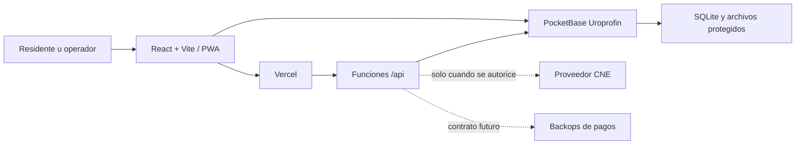

# Arquitectura

## Vista general



- El cliente web vive en Vercel y puede empaquetarse con Capacitor.
- PocketBase autentica usuarios, aplica reglas por colección, persiste datos y entrega archivos protegidos.
- Las funciones de Vercel contienen integraciones que no deben exponer credenciales al navegador.
- CNE y backops son adaptadores externos; no forman parte del núcleo y están cerrados hasta configurarlos.

## Modelo multi-comuna

Toda entidad operativa debe incluir la relación `community`. La jerarquía principal es:

```text
commune
└── sector
    └── household
        ├── resident
        └── community_membership
```

Colecciones funcionales recomendadas:

- Identidad y acceso: `users`, `communes`, `community_memberships`, `membership_requests`.
- Censo: `sectors`, `households`, `residents`, `resident_change_requests`, `electoral_profiles`, `cne_query_attempts`.
- CLAP: `distribution_cycles`, `bag_allocations`, `payment_reports`, `payment_allocations`, `pickup_authorizations`, `pickup_batches`, `pickup_lines`, `delivery_confirmations`, `delivery_self_reports`.
- Comunidad: `community_reports`, `community_report_events`, `survey_campaigns`, `survey_responses`.
- Campañas: `toy_campaigns`, `toy_allocations`.
- Operación: `import_batches`, `payment_import_staging`, `audit_events`.

Los archivos deben guardarse en campos `file` protegidos de PocketBase; nunca como Base64 dentro de JSON.

## Roles

| Capacidad | Administrador | Colaborador | Regular |
|---|---:|---:|---:|
| Ver toda su comuna | Sí | Según función | No |
| Crear/actualizar censo | Sí | Sí | No |
| Eliminar registros | Sí, con auditoría | No | No |
| Validar/rechazar pagos | Sí o backops | No | No |
| Registrar logística/entrega | Sí | Sí | Autorreporte propio |
| Reportar incidencias | Sí | Sí | Sí |
| Ver caso sensible privado | Solo equipo autorizado | No por defecto | Solo el propio, si aplica |

El rol pertenece a una membresía de una comuna, no al usuario global. Una misma cuenta puede tener funciones diferentes en comunas diferentes.

## Reglas de dominio

- La edad se deriva de `birthDate`; una fecha desconocida permanece nula y no se convierte en edad cero.
- La bolsa de cortesía es una asignación con tipo, motivo y aprobador; no un pago de importe cero.
- Un pago puede distribuirse entre varias asignaciones mediante `payment_allocations`.
- El retiro de terceros usa lote y líneas. La suma confirmada por recolector no puede exceder 17 bolsas por traslado.
- El autorreporte de entrega del residente no reemplaza la confirmación oficial del operador.
- Las métricas electorales y demográficas solo incluyen registros con evidencia suficiente y muestran cobertura.

## Fuente de verdad

PocketBase usa SQLite de forma interna y es la única fuente operacional del MVP. Si más adelante se necesita PostgreSQL para análisis, debe recibir una réplica/exportación de solo lectura o una migración planificada; no se debe implementar escritura doble.
